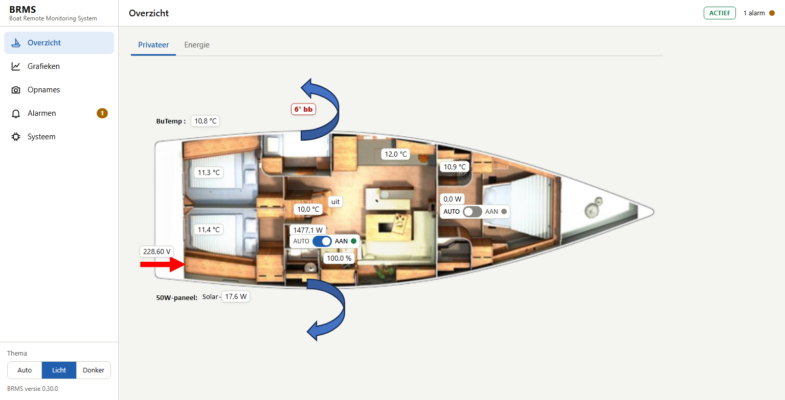
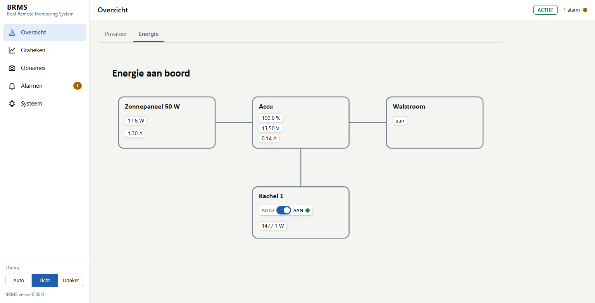
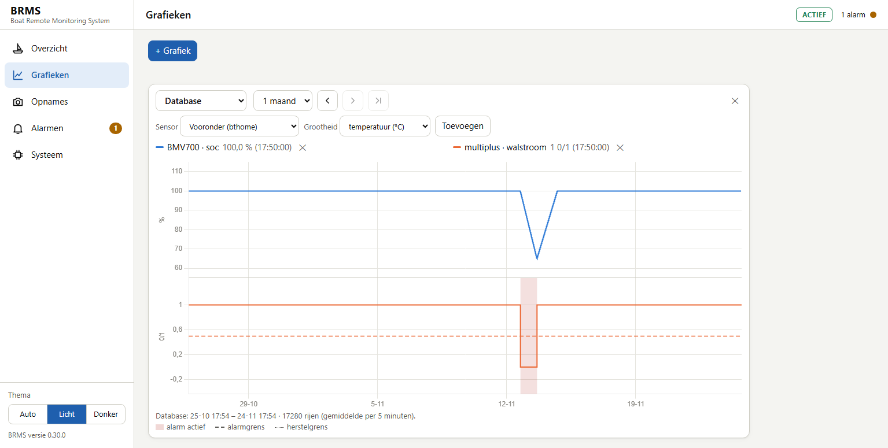
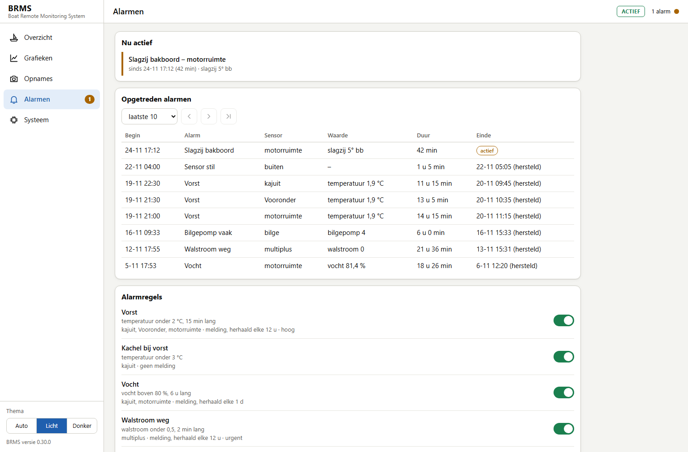
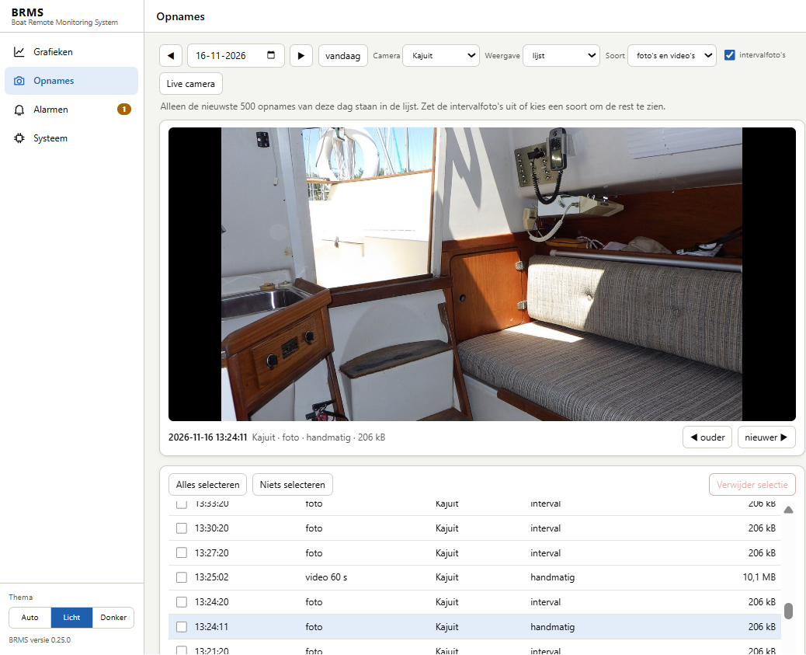
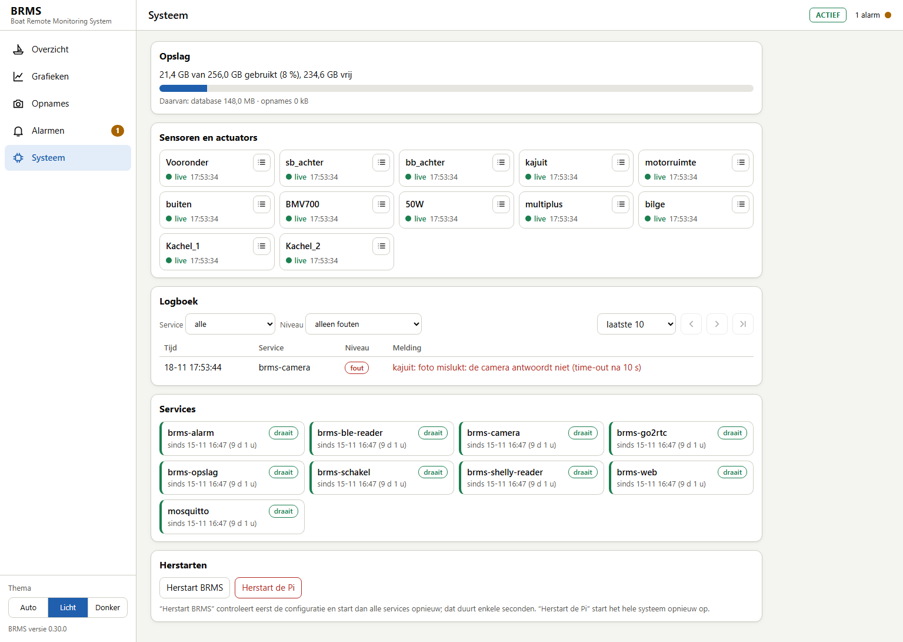
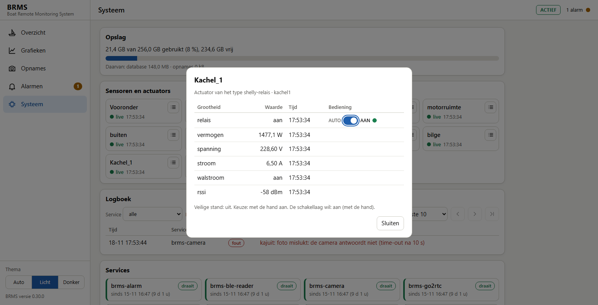
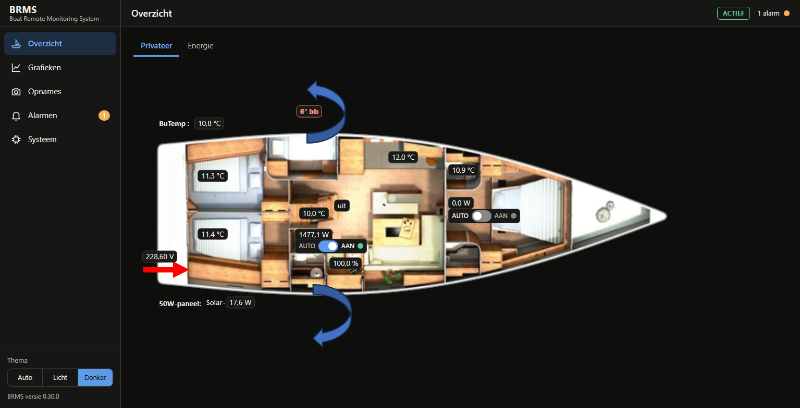

# BRMS – Boot Remote Monitoring Systeem

BRMS bewaakt een boot die maanden onbeheerd in de haven ligt. Een Raspberry Pi aan boord
leest draadloze sensoren uit, bewaart de metingen lokaal en stuurt een melding als er iets
mis is: vorst, vocht, walstroom weg, accu laag, een bilgepomp die te vaak loopt of een
sensor die zwijgt. Thuis bekijk je grafieken, alarmen en camerabeelden in de browser, via
een VPN (Tailscale).

*In English: BRMS is a small, self-hosted remote monitoring system for a (sail)boat in
winter storage. A Raspberry Pi reads Bluetooth LE and wifi sensors (temperature, humidity,
battery, shore power, solar, bilge pump, IP camera), stores everything locally in SQLite
and sends alarms by Telegram and e-mail. No cloud, no Home Assistant. The interface and
the documentation are in Dutch.*

## Wat het doet

- **Meten** – temperatuur en luchtvochtigheid (Xiaomi met BTHome v2, RuuviTag), accu,
  zonnepanelen en walstroom (Victron Instant Readout), bilgepomp (Shelly Plus Uni),
  beweging en slagzij (RuuviTag).
- **Bewaren** – alles lokaal in SQLite, één rij per 5 minuten; bestand tegen stroomuitval.
- **Alarmeren** – eigen alarmregels met grens, duur en herstel; meldingen via Telegram en
  e-mail, desgewenst met een foto van het moment.
- **Schakelen** – een elektrische kachel bij vorst, via een tussenstekker (Shelly Plug M
  Gen3); alleen met walstroom, en de stekker schakelt zelf uit als BRMS wegvalt. Vanzelf
  door een alarmregel, of met de hand met een schuifknop in het web (AUTO / AAN). Na een
  herstart staat elk relais weer op AUTO, in zijn veilige stand.
- **Kijken** – webinterface met grafieken (live en historisch), opnames van de camera's,
  live-beeld, de stand van elke sensor en een logboek van het systeem. Desgewenst met de
  pagina Overzicht als eerste pagina: je eigen tekeningen (SVG), elk op een tab, met op
  elke plek de actuele waarde. Licht en donker thema, ook bruikbaar op een telefoon.
- **Onbeheerd draaien** – eigen Python-code met weinig afhankelijkheden, systemd-services
  die vanzelf herstarten, geen clouddienst nodig, niets open op internet.

## Schermafdrukken

De schermafdrukken tonen de echte webinterface (versie 0.30) met gesimuleerde metingen.

**Overzicht** – je eigen tekening van de boot, met op elke plek de actuele waarde: temperatuur
per ruimte, laadtoestand van de accu, de bilgepomp, spanning en vermogen van de kachels en
de slagzij. Een waarde met een actief alarm staat rood en vet (hier: 6° slagzij over
bakboord); een sensor die zwijgt toont `--`. Een klik op een waarde opent de grafiek ervan.
Bij elke kachel staat de schuifknop: de ene kachel staat met de hand aan, de andere op AUTO.



Elke tekening heeft een eigen tab. Hier een tweede tekening, een eenvoudig schema van de
energie aan boord:



#### Je eigen tekening

De pagina Overzicht gebruikt je eigen tekening: BRMS levert er geen mee. Zo maak je haar:

1. **Teken de boot** in een programma naar keuze en sla de tekening op als SVG. Een dia
   uit PowerPoint werkt goed (Opslaan als → SVG): een plattegrond of foto van de boot als
   achtergrond, met eventueel een titel en pijlen erbij.
2. **Zet de waarden op hun plek.** Typ op elke plek waar een waarde moet komen een
   tekstvak met `sensor.grootheid`: de naam van de sensor uit `brms.toml`, een punt en de
   grootheid. Bijvoorbeeld `kajuit.temperatuur`, `accu.soc`, `bilge.bilgepomp` of
   `kachel.vermogen`. Hoofdletters tellen niet mee. Welke grootheden een sensor levert,
   toont `brms grootheden <type>`. Een relais bedienen vanuit de tekening kan ook: zie
   "Een relais bedienen vanuit de tekening" hieronder.
3. **Zet het bestand op de Pi**, in de map `config/` naast `brms.toml`, bijvoorbeeld vanaf
   je pc met `scp boot.svg brms:BRMS/config/`.
4. **Zet de pagina aan** met twee regels in `brms.toml`, en herstart één keer met
   `brms herstart`:

   ```toml
   [boot]
   tekening = "boot.svg"     # het bestand staat naast brms.toml
   ```

   Met een lijst krijgt elke tekening een eigen tab, in de volgorde van de lijst; de tab
   heet naar het bestand zonder `.svg`:

   ```toml
   [boot]
   tekening = ["Privateer.svg", "Victron.svg"]
   ```

BRMS haalt de teksten `sensor.grootheid` uit de tekening en zet op de plek van de eerste
letter een vakje met de actuele waarde. Alle andere tekst (een titel, een bijschrift) en
alles wat je getekend hebt, blijft staan. Er staat verder niets over plekken in
`brms.toml`: een waarde toevoegen of verplaatsen doe je in de tekening. Zet daarna het
nieuwe bestand op de Pi en ververs de pagina; herstarten hoeft dan niet.

Staat de slagzij twee keer in de tekening (boven voor bakboord, onder voor stuurboord),
dan verschijnt de waarde alleen aan de kant waar de boot naartoe helt. Op een telefoon die
rechtop staat, draait de tekening een kwartslag, met de boeg naar boven.

#### Een relais bedienen vanuit de tekening

Een relais (de tussenstekker van de kachel) kun je in de tekening niet alleen aflezen, maar
ook bedienen. Dat vraagt twee dingen:

1. **Sta de bediening toe in `brms.toml`**, met de regel `controls` bij de sensor:

   ```toml
   [[sensor]]
   type = "shelly-relais"
   id = "kachel"
   naam = "kachel"
   adres = "192.168.1.121"
   veilige_stand = "uit"
   voorwaarde = { kachel.walstroom = 1 }
   controls = ["relais"]     # deze grootheid mag bediend worden
   ```

   Welke grootheden van een type te bedienen zijn, toont `brms grootheden shelly-relais`
   in de kolom BEDIENING. Controleer en herstart daarna met `brms herstart`.
2. **Typ in de tekening een tekstvak met `.RW` achter de naam**: `kachel.relais.RW`. Op
   die plek komt de schuifknop. Zet het nieuwe bestand op de Pi en ververs de pagina.

De toevoeging achter de naam bepaalt wat er op die plek komt:

| In de tekening | Op die plek |
|---|---|
| `kachel.relais` | de waarde, alleen lezen |
| `kachel.relais.RO` | hetzelfde (RO = read only) |
| `kachel.relais.RW` | de bediening (RW = read write): de schuifknop |

Dezelfde grootheid mag er vaker in staan, bijvoorbeeld op één plek de schuifknop en op een
andere het vermogen (`kachel.vermogen`). Staat de grootheid niet in `controls`, dan gebeurt
er met `kachel.relais.RW` niets: de tekst blijft in de tekening staan zoals je hem typte.

De schuifknop heeft twee keuzes:

- **AUTO** – BRMS beslist: het relais volgt de alarmregel die het schakelt (de kachel aan
  bij vorst) en staat anders in zijn veilige stand.
- **AAN** – met de hand aan, tot je terugzet naar AUTO. Bij een relais met
  `veilige_stand = "aan"` is de tweede keuze **UIT**.

De stip naast de knop toont de werkelijke stand van het relais. De `voorwaarde` van het
relais (hier: walstroom aanwezig) gaat voor alles: zonder walstroom blijft de kachel uit,
ook met de knop op AAN. Na een herstart staat elk relais weer op AUTO. Dezelfde schuifknop
staat op de pagina Systeem, in het venster van de sensor.

**Grafieken** – je stelt zelf samen wat je ziet: met "+ Grafiek" voeg je een grafiek toe
en kies je per reeks een sensor en een grootheid (hooguit acht reeksen per grafiek). Elke
grafiek heeft een eigen bron:

| Bron | Wat je ziet | Keuzes | Begint met |
|---|---|---|---|
| Live (MQTT-bus) | elke meting zoals hij binnenkomt, uit het geheugen van de webservice (hooguit 24 uur, leeg na een herstart) | laatste 50 of 100 metingen; 10 of 30 minuten; 1, 3, 6, 12 of 24 uur | laatste uur |
| Database | de opgeslagen rijen, één per 5 minuten | 1, 6 of 24 uur; 3 of 7 dagen; 1 maand | 24 uur |

Met `<` en `>` blader je terug en vooruit in stappen van een derde van de gekozen periode
(bij "laatste 50 / 100 metingen" de helft), zodat een deel van het vorige beeld blijft
staan; de derde knop brengt je terug naar nu.

Hieronder een week temperatuur van drie sensoren. De rode vlakken zijn de perioden waarin
het alarm "Vorst" actief was; de stippellijnen zijn de alarmgrens en de herstelgrens.


Een maand laadtoestand van de accu en de walstroom: de walstroom viel bijna een dag weg.



**Alarmen** – wat er nu actief is, wat er eerder is opgetreden, en de alarmregels met hun
schakelaar.



**Opnames** – elke paar minuten een foto per camera, een foto of video bij een alarm of op
verzoek, en live-beeld.



**Systeem** – de opslag, het logboek, de services en het herstarten van BRMS of de Pi. In
het blok "Sensoren en actuators" staat per sensor een tegel met een stip (groen: live,
rood: geen metingen) en het tijdstip van de laatste meting. De knop op de tegel opent een
venster met alle grootheden van die sensor en hun laatste waarde; bij een relais staat
daar ook de schuifknop AUTO / AAN.



Het venster van een kachel, met de schuifknop op AAN:



### Donker thema

Elke pagina is er in een licht en een donker thema. Onderin het menu kies je **Auto**
(volgt de instelling van het toestel), **Licht** of **Donker**; de keuze wordt per browser
onthouden. Handig als je 's avonds nog even kijkt hoe de boot erbij ligt.

De pagina Overzicht: de vakjes met de waarden en de tekst in de tekening kleuren mee, de
tekening zelf blijft zoals je haar getekend hebt.



De grafieken, met dezelfde week temperatuur en het vorstalarm:


De alarmen, met het actieve alarm voor de slagzij:


## Wat je nodig hebt

- Raspberry Pi 4 met Raspberry Pi OS Lite (64-bit), opslag op USB.
- Een router met internet aan boord (hier een Teltonika RUT241 met 4G).
- Sensoren naar keuze: Xiaomi Monitor 3 met pvvx-firmware (zie `FLASH_XIAOMI.md`),
  RuuviTag, Victron met Bluetooth, Shelly Plus Uni, Shelly Plug M Gen3, een IP-camera
  met RTSP.

De volledige lijst met keuzes en redenen staat in `CLAUDE.md` en `ARCHITECTURE.md`.

## Installeren (vanaf GitHub)

Op een verse Pi, als gewone gebruiker (niet met `sudo` ervoor):

```bash
curl -fsSLO https://raw.githubusercontent.com/jdderijke/BRMS/main/deploy/install.sh
bash install.sh
```

1. Het script haalt de code via https op naar `~/BRMS`, installeert de pakketten,
   Mosquitto, de systemd-services en Tailscale, en zet de opdracht `brms` klaar. Het vraagt
   zelf om het sudo-wachtwoord en is veilig om opnieuw te draaien. Werk je met een eigen
   fork, zet dan eerst het adres daarvan bij `REPO=` bovenin het script.
2. Vul je eigen sensoren, camera's, alarmregels en meldingen in en herstart:

   ```bash
   nano ~/BRMS/config/brms.toml     # uitleg staat in het bestand zelf
   brms herstart                    # controleert eerst de configuratie
   ```

3. Open de webinterface: `http://brms:8080` (via Tailscale of het netwerk aan boord).

Zonder sensoren uitproberen kan ook: `brms sim all` start een demo met gesimuleerde
waarden (bevestig, en geef bij de duur alleen Enter).

## De opdracht `brms`

| Opdracht | Wat het doet |
|---|---|
| `brms check-config` | De configuratie controleren, bijvoorbeeld vóór een herstart. |
| `brms start` / `brms stop` | Alle BRMS-services starten of stoppen. |
| `brms herstart` | Configuratie controleren en alle services herstarten, bijvoorbeeld na een wijziging van `brms.toml`. |
| `brms update` | De nieuwste versie van GitHub halen, ontbrekende pakketten installeren en herstarten. Bij een fout draait de oude versie door. |
| `brms update --terug` | Terug naar de versie van vóór de laatste update. |
| `brms monitor` | Meekijken met de metingen op de bus, onderin het scherm (tmux). |
| `brms monitor <sensor>` | Eén sensor volgen door de hele keten: ontvangen, gedecodeerd, opgeslagen. |
| `brms monitor stop` | Het monitorvak sluiten. |
| `brms sim <sensor ...>` | Gesimuleerde data door de keten sturen. Met een duur: een test die door de alarmgrenzen loopt. Alleen Enter: een demo die doorloopt. `all` = alle sensoren. |
| `brms sim stop <sensor ...>` | De simulatie of demo stoppen (ook `brms sim stop all`). |
| `brms grootheden [type]` | Alle grootheden, of wat een sensortype levert (de namen voor `brms.toml`). Bij een type toont de kolom BEDIENING welke grootheden te bedienen zijn. |

`brms --help` toont de volledige lijst. Op de pc werkt hetzelfde met `python -m brms ...`.

## Structuur

```
brms/            Python-package
  readers/       één module per sensortype (BTHome, Ruuvi, Victron, Shelly, camera)
  storage.py     SQLite (WAL)
  alarms.py      alarmlaag: alarmregels beoordelen
  schakel.py     schakellaag: beslist over de stand van elk relais (alarmregel of hand)
  melding.py     meldingen via Telegram en e-mail
  config.py      inlezen config/brms.toml
  go2rtc.py      live-beeld van de camera's via het programma go2rtc (WebRTC)
  systeem.py     logboek uit journald, status van de services, herstarten
  web/           Flask + Chart.js: overzicht, grafieken, opnames, alarmen en systeem
config/          brms.example.toml; eigen brms.toml ernaast (niet in git)
deploy/          install.sh, update.sh, go2rtc.sh (haalt go2rtc op naar bin/), rechten.sh
deploy/polkit/   polkit-regel: het web mag de services en de Pi herstarten
deploy/systemd/  service-bestanden
docs/            schermafdrukken voor deze README
bin/             het programma go2rtc (niet in git)
data/            SQLite-database en camera-opnames (niet in git)
tests/
```

De keten is: reader → MQTT (Mosquitto) → opslag → SQLite, met de alarmlaag, de
schakellaag en het web ernaast. Een relais schakelen gaat in drie stappen: de alarmlaag of
het web vraagt, de schakellaag beslist, de Shelly-reader voert uit. Het ontwerp, de
besluiten en de open punten staan in `ARCHITECTURE.md`.

## Verantwoording

De foto in de schermafdruk van de opnames is van Wikimedia Commons:
[Bayfield 25 sailboat Bay Dream interior](https://commons.wikimedia.org/wiki/File:Bayfield_25_sailboat_Bay_Dream_interior_4385.jpg)
door Ahunt, vrijgegeven onder CC0 (publiek domein).
