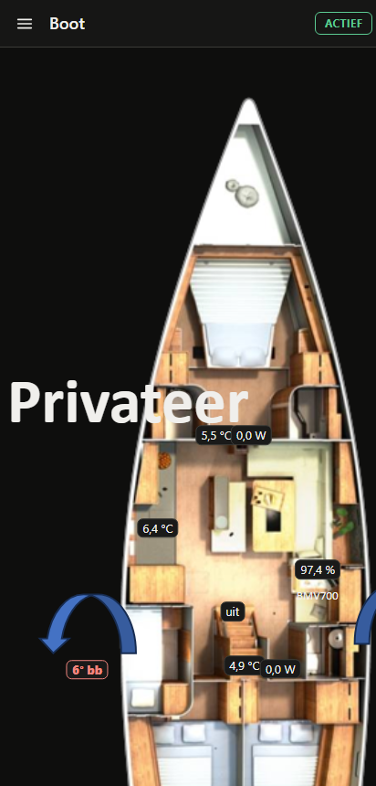
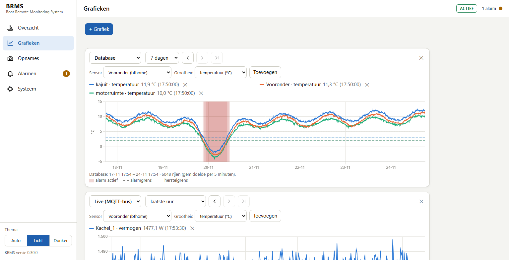
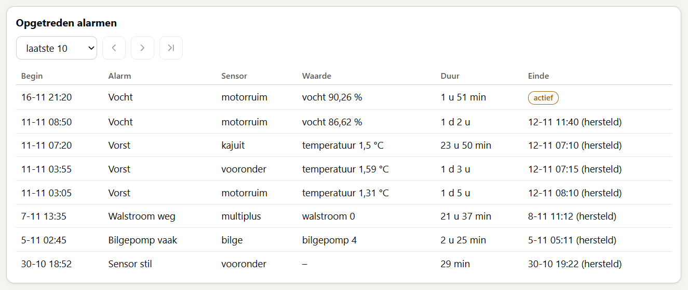
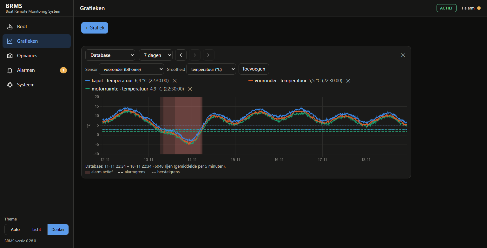
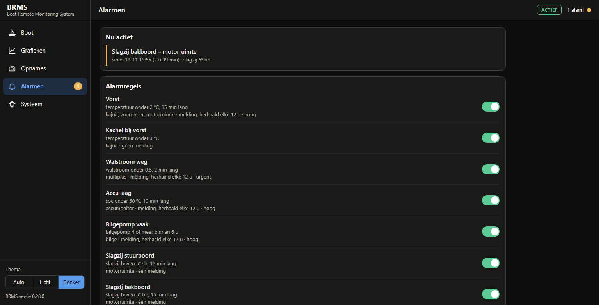

# BRMS – Boot Remote Monitoring Systeem

BRMS bewaakt een boot die maanden onbeheerd in de haven ligt. Een Raspberry Pi aan boord
leest draadloze sensoren uit, bewaart de metingen lokaal en stuurt een melding als er iets
mis is: vorst, vocht, walstroom weg, accu laag, een bilgepomp die te vaak loopt of een
sensor die zwijgt. Thuis bekijk je grafieken, alarmen en camerabeelden in de browser, via
een VPN (Tailscale).

*In English: BRMS is a small, self-hosted remote monitoring system for a (sail)boat in
winter storage. A Raspberry Pi reads Bluetooth LE and wifi sensors (temperature, humidity,
battery, shore power, solar, bilge pump, IP camera), stores everything locally in SQLite
and sends alarms by Telegram and e-mail. No cloud, no Home Assistant. The interface and
the documentation are in Dutch.*

## Wat het doet

- **Meten** – temperatuur en luchtvochtigheid (Xiaomi met BTHome v2, RuuviTag), accu,
  zonnepanelen en walstroom (Victron Instant Readout), bilgepomp (Shelly Plus Uni),
  beweging en slagzij (RuuviTag).
- **Bewaren** – alles lokaal in SQLite, één rij per 5 minuten; bestand tegen stroomuitval.
- **Alarmeren** – eigen alarmregels met grens, duur en herstel; meldingen via Telegram en
  e-mail, desgewenst met een foto van het moment.
- **Schakelen** – een elektrische kachel bij vorst, via een tussenstekker (Shelly Plug M
  Gen3); alleen met walstroom, en de stekker schakelt zelf uit als BRMS wegvalt.
- **Kijken** – webinterface met grafieken (live en historisch), opnames van de camera's,
  live-beeld en een logboek van het systeem. Desgewenst met een bootpagina als eerste
  pagina: je eigen tekening van de boot (SVG) met op elke plek de actuele waarde. Licht
  en donker thema, ook bruikbaar op een telefoon.
- **Onbeheerd draaien** – eigen Python-code met weinig afhankelijkheden, systemd-services
  die vanzelf herstarten, geen clouddienst nodig, niets open op internet.

## Schermafdrukken

De schermafdrukken tonen de echte webinterface met gesimuleerde metingen.

**Boot** – je eigen tekening van de boot, met op elke plek de actuele waarde: temperatuur
per ruimte, laadtoestand van de accu, de bilgepomp, spanning en vermogen van de kachels en
de slagzij. Een waarde met een actief alarm staat rood en vet (hier: 6° slagzij over
bakboord); een sensor die zwijgt toont `--`. Een klik op een waarde opent de grafiek ervan.


De tekening is één SVG-bestand, bijvoorbeeld een dia uit PowerPoint die je opslaat als SVG.
Op elke plek waar een waarde moet komen, zet je de tekst `sensor.grootheid`, bijvoorbeeld
`kajuit.temperatuur`; BRMS vervangt die tekst door de waarde. Een sensor toevoegen of
verplaatsen is dus alleen een wijziging van de tekening. Aanzetten gaat met twee regels in
`brms.toml`:

```toml
[boot]
tekening = "boot.svg"     # het bestand staat naast brms.toml
```

Op een telefoon die rechtop staat, draait de tekening een kwartslag: de boeg wijst naar
boven en de waarden blijven leesbaar.



**Grafieken** – een week temperatuur van drie sensoren. De rode vlakken zijn de perioden
waarin het alarm "Vorst" actief was; de stippellijnen zijn de alarmgrens en de herstelgrens.



Een maand laadtoestand van de accu en de walstroom: de walstroom viel bijna een dag weg.


**Alarmen** – wat er nu actief is, de alarmregels met hun schakelaar, en wat er eerder is
opgetreden.




**Opnames** – elke paar minuten een foto per camera, een foto of video bij een alarm of op
verzoek, en live-beeld.


### Donker thema

Elke pagina is er in een licht en een donker thema. Onderin het menu kies je **Auto**
(volgt de instelling van het toestel), **Licht** of **Donker**; de keuze wordt per browser
onthouden. Handig als je 's avonds nog even kijkt hoe de boot erbij ligt.

De bootpagina: de vakjes met de waarden en de tekst in de tekening kleuren mee, de
tekening zelf blijft zoals je haar getekend hebt.


De grafieken, met dezelfde week temperatuur en het vorstalarm:



De alarmen, met het actieve alarm voor de slagzij:



## Wat je nodig hebt

- Raspberry Pi 4 met Raspberry Pi OS Lite (64-bit), opslag op USB.
- Een router met internet aan boord (hier een Teltonika RUT241 met 4G).
- Sensoren naar keuze: Xiaomi Monitor 3 met pvvx-firmware (zie `FLASH_XIAOMI.md`),
  RuuviTag, Victron met Bluetooth, Shelly Plus Uni, Shelly Plug M Gen3, een IP-camera
  met RTSP.

De volledige lijst met keuzes en redenen staat in `CLAUDE.md` en `ARCHITECTURE.md`.

## Installeren (vanaf GitHub)

Op een verse Pi, als gewone gebruiker (niet met `sudo` ervoor):

```bash
curl -fsSLO https://raw.githubusercontent.com/jdderijke/BRMS/main/deploy/install.sh
bash install.sh
```

1. Het script haalt de code via https op naar `~/BRMS`, installeert de pakketten,
   Mosquitto, de systemd-services en Tailscale, en zet de opdracht `brms` klaar. Het vraagt
   zelf om het sudo-wachtwoord en is veilig om opnieuw te draaien. Werk je met een eigen
   fork, zet dan eerst het adres daarvan bij `REPO=` bovenin het script.
2. Vul je eigen sensoren, camera's, alarmregels en meldingen in en herstart:

   ```bash
   nano ~/BRMS/config/brms.toml     # uitleg staat in het bestand zelf
   brms herstart                    # controleert eerst de configuratie
   ```

3. Open de webinterface: `http://brms:8080` (via Tailscale of het netwerk aan boord).

Zonder sensoren uitproberen kan ook: `brms sim all` start een demo met gesimuleerde
waarden (bevestig, en geef bij de duur alleen Enter).

## De opdracht `brms`

| Opdracht | Wat het doet |
|---|---|
| `brms check-config` | De configuratie controleren, bijvoorbeeld vóór een herstart. |
| `brms start` / `brms stop` | Alle BRMS-services starten of stoppen. |
| `brms herstart` | Configuratie controleren en alle services herstarten, bijvoorbeeld na een wijziging van `brms.toml`. |
| `brms update` | De nieuwste versie van GitHub halen, ontbrekende pakketten installeren en herstarten. Bij een fout draait de oude versie door. |
| `brms update --terug` | Terug naar de versie van vóór de laatste update. |
| `brms monitor` | Meekijken met de metingen op de bus, onderin het scherm (tmux). |
| `brms monitor <sensor>` | Eén sensor volgen door de hele keten: ontvangen, gedecodeerd, opgeslagen. |
| `brms monitor stop` | Het monitorvak sluiten. |
| `brms sim <sensor ...>` | Gesimuleerde data door de keten sturen. Met een duur: een test die door de alarmgrenzen loopt. Alleen Enter: een demo die doorloopt. `all` = alle sensoren. |
| `brms sim stop <sensor ...>` | De simulatie of demo stoppen (ook `brms sim stop all`). |
| `brms grootheden [type]` | Alle grootheden, of wat een sensortype levert (de namen voor `brms.toml`). |

`brms --help` toont de volledige lijst. Op de pc werkt hetzelfde met `python -m brms ...`.

## Structuur

```
brms/            Python-package
  readers/       één module per sensortype (BTHome, Ruuvi, Victron, Shelly, camera)
  storage.py     SQLite (WAL)
  alarms.py      alarmlaag: alarmregels beoordelen
  melding.py     meldingen via Telegram en e-mail
  config.py      inlezen config/brms.toml
  go2rtc.py      live-beeld van de camera's via het programma go2rtc (WebRTC)
  systeem.py     logboek uit journald, status van de services, herstarten
  web/           Flask + Chart.js: boot, grafieken, opnames, alarmen en systeem
config/          brms.example.toml; eigen brms.toml ernaast (niet in git)
deploy/          install.sh, update.sh, go2rtc.sh (haalt go2rtc op naar bin/), rechten.sh
deploy/polkit/   polkit-regel: het web mag de services en de Pi herstarten
deploy/systemd/  service-bestanden
docs/            schermafdrukken voor deze README
bin/             het programma go2rtc (niet in git)
data/            SQLite-database en camera-opnames (niet in git)
tests/
```

De keten is: reader → MQTT (Mosquitto) → opslag → SQLite, met de alarmlaag en het web
ernaast. Het ontwerp, de besluiten en de open punten staan in `ARCHITECTURE.md`.

## Verantwoording

De foto in de schermafdruk van de opnames is van Wikimedia Commons:
[Bayfield 25 sailboat Bay Dream interior](https://commons.wikimedia.org/wiki/File:Bayfield_25_sailboat_Bay_Dream_interior_4385.jpg)
door Ahunt, vrijgegeven onder CC0 (publiek domein).
